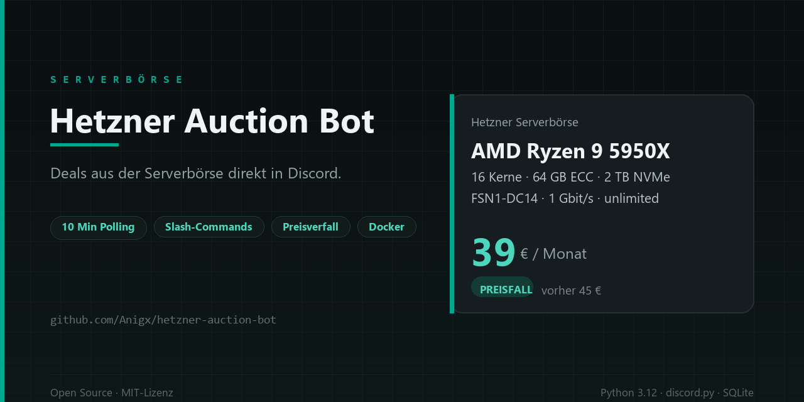

# Hetzner-Auktions-Bot für Discord

Beobachtet die [Hetzner-Serverbörse](https://www.hetzner.com/sb/) und postet neue
passende Server in einen Discord-Kanal. Jede Person legt per Slash-Command eigene
Filter an und entscheidet, ob sie bei Treffern getaggt werden will.

- Prüft alle 10 Minuten mit einem einzigen HTTP-Request pro Lauf
- Postet nur Server, die zu mindestens einem Filter passen
- Jeder Server erscheint einmal; fällt er im Preis, kommt eine zweite Meldung mit
  altem und neuem Preis
- Läuft als Docker-Container, Zustand in SQLite

## Bot bei Discord anlegen

1. Im [Discord Developer Portal](https://discord.com/developers/applications) eine
   Application anlegen und darin einen Bot.
2. Token kopieren.
3. Unter *OAuth2 → URL Generator* die Scopes `bot` und `applications.commands`
   wählen, Berechtigungen: *Nachrichten senden*, *Links einbetten*,
   *Erwähnungen von @everyone/@here verbieten* (optional).
4. Bot über die erzeugte URL auf den Server einladen. **Wichtig:** Das muss ein
   Discord-Server sein — in echte Gruppen-DMs lassen sich Bots nicht einladen.

## Start

```bash
cp .env.example .env
# DISCORD_TOKEN in .env eintragen
mkdir -p data
sudo chown 10001:10001 data      # Container laeuft als uid 10001
docker compose up -d --build
docker compose logs -f bot
```

Ohne `DISCORD_TOKEN` bricht der Start mit einer klaren Meldung ab.

Das `data/`-Verzeichnis muss vor dem ersten Start existieren und dem Container-User
gehören — sonst legt Docker es als `root` an und der Bot kann die SQLite-Datei
nicht öffnen.

## Benutzung

```
/setup channel:#server-deals     # einmalig, braucht "Server verwalten"
/watch max_price:50 min_ram:64 min_cores:16 mention:true
/watch name:ryzen cpu:"Ryzen 9" min_disk:2 disk_type:nvme mention:true
/filters
/pause name:standard
/resume name:standard
/unwatch name:standard
/status
```

Beim Anlegen eines Filters werden die aktuell passenden Server nur gezählt, nicht
gepostet — sonst würde der Kanal mit Altbestand geflutet.

Alle Optionen von `/watch`: `max_price` (€/Monat), `min_ram` (GB), `min_cores`,
`cpu` (Text im CPU-Namen), `min_disk` (TB), `disk_type` (`egal`/`nvme`/`sata`/`hdd`),
`location` (`FSN`/`NBG`/`HEL`), `ecc`, `no_setup`, `min_bandwidth` (Mbit/s),
`mention`.

Mindestens ein Kriterium muss gesetzt sein.

## Betrieb

```bash
docker compose ps               # Healthcheck-Status
docker compose logs -f bot      # JSON-Zeilen
docker compose restart bot
rm data/bot.sqlite3             # alles zurücksetzen (Filter, Verlauf)
```

Der Healthcheck prüft `data/last_poll`: Ist der letzte erfolgreiche Abruf älter als
30 Minuten, gilt der Container als unhealthy. Zusätzlich meldet sich der Bot selbst
im Kanal, wenn er dreimal hintereinander keine Daten bekommt.

Optionale Umgebungsvariablen: `AUCTION_URL` (andere Datenquelle),
`LAST_POLL_FILE` und `MAX_POLL_AGE_MINUTES` (Healthcheck), `POLL_MINUTES`,
`MAX_POSTS_PER_RUN`, `LOG_LEVEL`.

## Entwicklung

```bash
uv venv --python 3.12 .venv
uv pip install -r requirements.txt --python .venv/Scripts/python.exe
.venv/Scripts/python.exe -m pytest -q
```

Tests sprechen nie mit dem Netz: Sie nutzen den Snapshot in
`tests/fixtures/auction_snapshot.json` und `httpx.MockTransport`.

Die Kernzahlen der CPUs stehen in `hetzner/cpus.py`. Kommt in der Auktion ein neues
Modell dazu, schlägt `test_every_cpu_in_fixture_is_known` fehl — dann Tabelle
ergänzen und den Snapshot neu ziehen.

Das Banner entsteht aus `tools/make_banner.py` (braucht `pillow`, nur zum Bauen):

```bash
uv pip install pillow --python .venv/Scripts/python.exe
.venv/Scripts/python.exe tools/make_banner.py
```

## Dokumentation

- Design: `docs/superpowers/specs/2026-10-29-hetzner-auktion-discord-bot-design.md`
- Plan: `docs/superpowers/plans/2026-10-29-hetzner-auktion-discord-bot.md`
- Projekt-Wiki: `AGENTS.md`, `TASKS.md`, `CHANGELOG.md`
